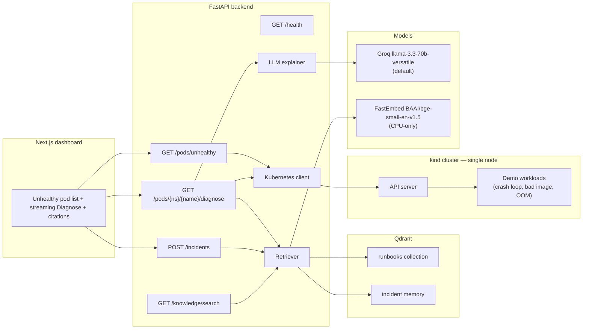

# Kube Copilot

**An AI incident copilot for Kubernetes.** Point it at a cluster, get a plain-English explanation of what broke, a short list of `kubectl` commands to fix it, and citations from runbooks and past incidents.

Phase 2 (this repo state) adds retrieval-augmented generation: markdown runbooks (and any incidents you save) are embedded with a small CPU-only model and stored in Qdrant. Diagnose still works if Qdrant is down — you just get an empty citations list and a warning flag.

This project is built to be resume-ready for DevOps, full-stack GenAI, and ML internship / GSoC / LFX applications. Later phases add an ML anomaly detector on Prometheus metrics and production-style packaging (Helm, GitHub Actions, Terraform, Grafana).

## The problem

When a pod goes into `CrashLoopBackOff`, `ImagePullBackOff`, or `OOMKilled`, the signal is scattered across `kubectl describe`, events, and current vs. previous logs. Junior operators (and tired senior ones) spend the first five minutes just assembling context. Kube Copilot does that gathering for you, retrieves the closest runbook sections, and returns a root-cause hypothesis you can verify — with citations.

## Architecture (Phase 2)



The backend talks to the cluster with the official Python `kubernetes` client and to the model via an OpenAI-compatible API (`LLM_BASE_URL`, `LLM_API_KEY`, `LLM_MODEL`). Groq is the default because it is fast and has a free tier that is enough for local demos; swapping in OpenAI or a local Ollama instance is a three-line `.env` change.

Embeddings default to [FastEmbed](https://qdrant.github.io/fastembed/) with `BAAI/bge-small-en-v1.5` on CPU — nothing heavy runs on the GPU, and the model is only downloaded the first time you run `make ingest`. Tests use a deterministic hash embedder so they never download a model.

Qdrant can run three ways:

- **Docker** (default): `make qdrant-up` exposes `http://localhost:6333`.
- **On-disk embedded store** (no extra container, kinder to a low-spec laptop): set `QDRANT_PATH=.qdrant` and leave `QDRANT_URL` empty or set it to `path`.
- **In-memory**: `QDRANT_URL=:memory:` — used automatically by the test suite.

## Repository layout

```
kube-copilot/
├── backend/            FastAPI app, RAG helpers, tests, Dockerfile
├── frontend/           Next.js (App Router, TypeScript, Tailwind)
├── knowledge/runbooks  Markdown runbooks ingested into Qdrant
├── demo/               kind config + intentionally broken manifests
├── Makefile            cluster-up, qdrant-up, ingest, demo-break, backend-dev, test
├── docker-compose.yml  Qdrant + optional API + UI containers
└── .env.example        Groq defaults, Qdrant, and OpenAI / Ollama examples
```

## Quickstart

You will need: **Python 3.11+**, **Node 20+**, **Docker**, **[kind](https://kind.sigs.k8s.io/)**, and **kubectl**. A single-node kind cluster is enough — the demo is sized for a low-spec laptop (one control-plane, `busybox` images, tight memory limits).

### 1. Clone and configure the LLM

```bash
git clone https://github.com/Kayd-06/kube-copilot.git
cd kube-copilot
cp .env.example .env
```

Create a free Groq key at [console.groq.com/keys](https://console.groq.com/keys) and put it in `.env`:

```bash
LLM_BASE_URL=https://api.groq.com/openai/v1
LLM_API_KEY=gsk_...
LLM_MODEL=llama-3.3-70b-versatile
```

Want OpenAI or a local model instead?

```bash
# OpenAI
LLM_BASE_URL=https://api.openai.com/v1
LLM_API_KEY=sk-...
LLM_MODEL=gpt-4o-mini

# Ollama (after: ollama pull llama3.2)
LLM_BASE_URL=http://localhost:11434/v1
LLM_API_KEY=ollama
LLM_MODEL=llama3.2
```

The backend loads `.env` automatically if you start it from the repo root or copy the file into `backend/`. The Makefile targets below export nothing special — the simplest path is:

```bash
# so pydantic-settings finds the file when you run uvicorn from backend/
cp .env backend/.env
```

### 2. Create a tiny cluster and break a few pods

```bash
make cluster-up     # kind cluster named kube-copilot, one node
make demo-break     # CrashLoopBackOff, ImagePullBackOff, and OOMKilled
kubectl get pods -n copilot-demo
```

### 3. Start Qdrant and ingest runbooks

```bash
make qdrant-up      # docker compose up -d qdrant  (http://localhost:6333)
cd backend
python3 -m venv .venv
source .venv/bin/activate
pip install -r requirements.txt
cd ..
make ingest         # python -m app.ingest — embeds knowledge/runbooks
```

The first ingest downloads the small FastEmbed model (CPU only) and upserts heading-level chunks from the 12 runbooks. Re-running `make ingest` is idempotent.

If you would rather not run another container, skip `make qdrant-up` and in `.env` set:

```bash
QDRANT_URL=path
QDRANT_PATH=.qdrant
```

Then run `make ingest` as usual.

### 4. Start the backend

```bash
cd backend
source .venv/bin/activate
cp ../.env .env      # if you have not already
python -m pytest -v
uvicorn app.main:app --reload --host 0.0.0.0 --port 8000
```

Or from the repo root, after the venv exists: `make test` and `make backend-dev`.

Check it: [http://localhost:8000/health](http://localhost:8000/health) should return `{"status":"ok",...}`. Unhealthy pods are at [http://localhost:8000/pods/unhealthy](http://localhost:8000/pods/unhealthy). You can probe retrieval with [http://localhost:8000/knowledge/search?q=CrashLoopBackOff](http://localhost:8000/knowledge/search?q=CrashLoopBackOff).

Diagnose still works if Qdrant is not running. The response will have `"citations": []` and `"knowledge_unavailable": true`.

### 5. Start the dashboard

In another terminal:

```bash
cd frontend
npm install
npm run dev
```

Open [http://localhost:3000](http://localhost:3000), click **Diagnose** on a failing pod, watch the answer stream in, and read the citations underneath. After a fix you can press **Save as resolved incident** so later diagnoses can retrieve that write-up too.

`make frontend-dev` does the same once `npm install` has been run once.

## API

| Method | Path | Description |
|--------|------|-------------|
| `GET`  | `/health` | Liveness. Does not touch the cluster, Qdrant, or the LLM. |
| `GET`  | `/pods/unhealthy` | Pods in a bad state (`CrashLoopBackOff`, `Error`, `Pending`, `OOMKilled`, `ImagePullBackOff`, …). Optional `?namespace=`. |
| `GET`  | `/pods/{namespace}/{name}/diagnose` | Collects status, events, and ~200 lines of logs, retrieves top-k runbook/incident chunks, and returns a structured diagnosis plus `citations`. |
| `GET`  | `/pods/{namespace}/{name}/diagnose?stream=true` | Same, as server-sent events (`context`, `citations`, `token`, `diagnosis`, `done`; `warning` if Qdrant is down). |
| `POST` | `/incidents` | Save a resolved incident (`pod_name`, `namespace`, `reason`, `root_cause`, `fix`, optional `notes`) into the incidents collection. |
| `GET`  | `/knowledge/search?q=` | Debug search over runbooks and incidents. Optional `&k=5`. |

A diagnosis looks like:

```json
{
  "summary": "…",
  "likely_root_cause": "…",
  "suggested_fix": "…",
  "kubectl_commands": ["kubectl describe pod …", "kubectl logs … --previous"],
  "confidence": 0.86,
  "citations": [
    {
      "title": "CrashLoopBackOff",
      "source": "crashloopbackoff.md",
      "section": "Common causes",
      "score": 0.81,
      "kind": "runbook"
    }
  ],
  "knowledge_unavailable": false
}
```

`citations` entries always include `title`, `source`, `section`, and `score`.

## Tests

Backend tests mock the Kubernetes and LLM clients and use an in-memory Qdrant plus a deterministic fake embedder. No cluster, API key, or model download is required:

```bash
cd backend && python -m pytest -v
```

## Docker Compose (optional)

```bash
cp .env.example .env   # add LLM_API_KEY
docker compose up --build
docker compose exec backend python -m app.ingest
```

The UI is on `:3000`, the API on `:8000`, and Qdrant on `:6333`. Compose mounts `~/.kube` into the API container. **kind advertises the API server as `127.0.0.1`**, which from inside a container is the container itself, not your host. The most reliable workflow is therefore `make qdrant-up && make ingest && make backend-dev` on the host, where your kubeconfig already works. If you want Compose to reach kind, change the server URL in the mounted kubeconfig to `host.docker.internal` (or use [this kind note](https://kind.sigs.k8s.io/docs/user/ingress/)).

## Roadmap

**Phase 1 — working core.** List unhealthy pods, gather evidence, LLM diagnosis, Next.js UI, kind demo cluster.

**Phase 2 — RAG with Qdrant (current).** Embed official-style runbooks and past incident write-ups in Qdrant. The explainer retrieves the closest fixes, streams the answer, and cites them instead of guessing from logs alone.

**Phase 3 — ML anomaly detection.** Scrape Prometheus metrics, train an anomaly detector (Isolation Forest, then an LSTM), track experiments with MLflow, and serve the model as its own microservice so the copilot can flag issues *before* a pod enters a terminal wait reason.

**Phase 4 — DevOps polish.** Docker images already exist; this phase adds Helm charts, GitHub Actions CI/CD, Terraform for a small cloud environment, Grafana dashboards, a public demo, and an architecture-rich README.

## License

MIT © 2026 Kunal Dadlani
