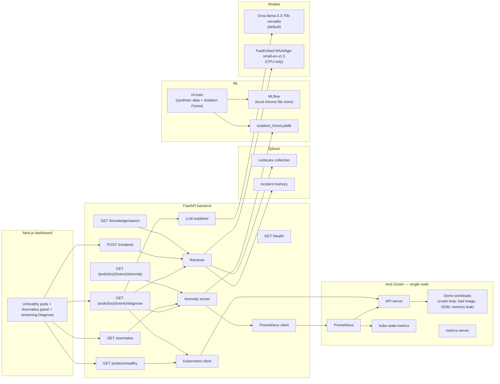

# Kube Copilot

**An AI incident copilot for Kubernetes.** Point it at a cluster, get a plain-English explanation of what broke, a short list of `kubectl` commands to fix it, citations from runbooks and past incidents, and an anomaly score over recent Prometheus metrics.

Phase 3 (this repo state) adds a lightweight metrics pipeline and an Isolation Forest that flags unusual CPU, memory, and restart patterns — including a slow memory leak that has not yet been OOMKilled. Diagnoses still work if Prometheus or the model is missing; you just get an `anomaly_unavailable` flag.

This project is built to be resume-ready for DevOps, full-stack GenAI, and ML internship / GSoC / LFX applications. The last phase adds production-style packaging (Helm, GitHub Actions, Terraform, Grafana).

## The problem

When a pod goes into `CrashLoopBackOff`, `ImagePullBackOff`, or `OOMKilled`, the signal is scattered across `kubectl describe`, events, and current vs. previous logs. Junior operators (and tired senior ones) spend the first five minutes just assembling context. Some problems, like a memory leak, are visible in metrics *before* the pod enters a terminal wait reason. Kube Copilot gathers the evidence, retrieves the closest runbook sections, scores recent metrics, and returns a root-cause hypothesis you can verify — with citations.

## Architecture (Phase 3)



The backend talks to the cluster with the official Python `kubernetes` client, to Prometheus over its HTTP API (`PROMETHEUS_URL`), and to the model via an OpenAI-compatible API (`LLM_BASE_URL`, `LLM_API_KEY`, `LLM_MODEL`). Groq is the default because it is fast and has a free tier that is enough for local demos; swapping in OpenAI or a local Ollama instance is a three-line `.env` change.

Embeddings default to [FastEmbed](https://qdrant.github.io/fastembed/) with `BAAI/bge-small-en-v1.5` on CPU — nothing heavy runs on the GPU, and the model is only downloaded the first time you run `make ingest`. Tests use a deterministic hash embedder so they never download a model.

Qdrant can run three ways:

- **Docker** (default): `make qdrant-up` exposes `http://localhost:6333`.
- **On-disk embedded store** (no extra container, kinder to a low-spec laptop): set `QDRANT_PATH=.qdrant` and leave `QDRANT_URL` empty or set it to `path`.
- **In-memory**: `QDRANT_URL=:memory:` — used automatically by the test suite.

Prometheus, kube-state-metrics, and metrics-server are optional. They are installed with tight resource requests (`make metrics-up`) and exposed on the host with `make metrics-forward`. If Prometheus is down, `/anomalies` returns HTTP 503 and Diagnose still succeeds.

## Repository layout

```
kube-copilot/
├── backend/            FastAPI app, anomaly scorer, RAG helpers, tests, Dockerfile
├── backend/models/     Trained Isolation Forest artifact (committed)
├── frontend/           Next.js (App Router, TypeScript, Tailwind)
├── ml/                 Synthetic data, feature engineering, training, eval reports
├── knowledge/runbooks  Markdown runbooks ingested into Qdrant
├── demo/               kind config, broken manifests, tiny Prometheus stack
├── Makefile            cluster, metrics, train, ingest, dev, test targets
├── docker-compose.yml  Qdrant + optional API + UI containers
└── .env.example        Groq defaults, Qdrant, Prometheus, and OpenAI / Ollama examples
```

## Quickstart

You will need: **Python 3.11+**, **Node 20+**, **Docker**, **[kind](https://kind.sigs.k8s.io/)**, and **kubectl**. A single-node kind cluster is enough — the demo is sized for a low-spec laptop (one control-plane, `busybox` images, tight memory limits). Prometheus and Qdrant are optional and can be skipped.

### 1. Clone and configure the LLM

```bash
git clone https://github.com/Kayd-06/kube-copilot.git
cd kube-copilot
cp .env.example .env
```

Create a free Groq key at [console.groq.com/keys](https://console.groq.com/keys) and put it in `.env`:

```bash
LLM_BASE_URL=https://api.groq.com/openai/v1
LLM_API_KEY=gsk_...
LLM_MODEL=llama-3.3-70b-versatile
```

Want OpenAI or a local model instead?

```bash
# OpenAI
LLM_BASE_URL=https://api.openai.com/v1
LLM_API_KEY=sk-...
LLM_MODEL=gpt-4o-mini

# Ollama (after: ollama pull llama3.2)
LLM_BASE_URL=http://localhost:11434/v1
LLM_API_KEY=ollama
LLM_MODEL=llama3.2
```

The backend loads `.env` automatically if you start it from the repo root or copy the file into `backend/`. The simplest path is:

```bash
cp .env backend/.env
```

### 2. Create a tiny cluster and break a few pods

```bash
make cluster-up     # kind cluster named kube-copilot, one node
make demo-break     # CrashLoopBackOff, ImagePullBackOff, OOMKilled, and a slow memory leak
kubectl get pods -n copilot-demo
```

### 3. Start Qdrant and ingest runbooks

```bash
make qdrant-up      # docker compose up -d qdrant  (http://localhost:6333)
cd backend
python3 -m venv .venv
source .venv/bin/activate
pip install -r requirements.txt
pip install -r ../ml/requirements.txt   # MLflow, only needed for `make train`
cd ..
make ingest         # python -m app.ingest — embeds knowledge/runbooks
```

The first ingest downloads the small FastEmbed model (CPU only) and upserts heading-level chunks from the runbooks. Re-running `make ingest` is idempotent.

If you would rather not run another container, skip `make qdrant-up` and in `.env` set:

```bash
QDRANT_URL=path
QDRANT_PATH=.qdrant
```

Then run `make ingest` as usual.

### 4. (Optional) Start Prometheus and train the anomaly model

A trained Isolation Forest is already committed at `backend/models/isolation_forest.joblib`, so scoring works out of the box. Retrain any time with:

```bash
make train          # writes the model, ml/reports/metrics.{json,md}, and an MLflow run
make mlflow-ui      # http://127.0.0.1:5000  (local file store ./mlruns)
```

`make train` is CPU-only and finishes in a few seconds. It does not need a cluster.

To score live pods you also need Prometheus:

```bash
make metrics-up          # Prometheus + kube-state-metrics + metrics-server, tight limits
make metrics-forward     # leave this running; http://localhost:9090
```

`PROMETHEUS_URL` defaults to `http://localhost:9090`. Wait about a minute after `metrics-up` for the first scrapes, then open the Anomalies panel. A background poller exists (`ANOMALY_POLLER_ENABLED=true`) but stays off by default so a low-spec laptop is not doing extra queries.

### 5. Start the backend

```bash
cd backend
source .venv/bin/activate
cp ../.env .env      # if you have not already
python -m pytest -v
uvicorn app.main:app --reload --host 0.0.0.0 --port 8000
```

Or from the repo root, after the venv exists: `make test` and `make backend-dev`.

Check it: [http://localhost:8000/health](http://localhost:8000/health) should return `{"status":"ok",...}`. Unhealthy pods are at [http://localhost:8000/pods/unhealthy](http://localhost:8000/pods/unhealthy). Anomaly scores are at [http://localhost:8000/anomalies](http://localhost:8000/anomalies). You can probe retrieval with [http://localhost:8000/knowledge/search?q=CrashLoopBackOff](http://localhost:8000/knowledge/search?q=CrashLoopBackOff).

Diagnose still works if Qdrant or Prometheus is not running. The response will have `"citations": []` / `"knowledge_unavailable": true`, or `"anomaly": null` / `"anomaly_unavailable": true`.

### 6. Start the dashboard

In another terminal:

```bash
cd frontend
npm install
npm run dev
```

Open [http://localhost:3000](http://localhost:3000). The Anomalies panel shows scores and a small memory sparkline; press **Diagnose** on a flagged pod (try `leak-app`) or on an unhealthy pod below. Watch the answer stream in, with citations and the anomaly breakdown underneath. After a fix you can press **Save as resolved incident** so later diagnoses can retrieve that write-up too.

`make frontend-dev` does the same once `npm install` has been run once.

## Phase 3 — ML anomaly detection

The detector is an Isolation Forest trained **only on synthetic normal windows**, so you can train it on a laptop with no cluster. A generator simulates healthy pods plus three labelled failure modes (memory leak, CPU spike, restart storm). Features are computed over a rolling 3-minute window (12 samples at 15s): rates, z-scores, memory-to-limit ratio, and restart deltas. The forest is fit on a smaller high-signal subset of those features (`cpu_last`, `cpu_mean`, `mem_zscore`, `mem_slope_mib_per_min`, `mem_to_limit_ratio`, `restart_delta`, `restart_rate_per_min`) because a rare behaviour that only shows up in one or two of many features is otherwise hard for Isolation Forest to isolate.

The decision threshold is the 90th percentile of training anomaly scores (an expected 10% false-positive rate on healthy windows). The served score is a sigmoid centred on that threshold, so `0.5` is the decision boundary and higher is more anomalous. Each response also lists the features with the largest z-score against the healthy training distribution.

### Evaluation (held-out synthetic test set)

These numbers come from a real `make train` run (seed `42`, 200 trees) at 2026-11-12 18:50 IST. The same figures are in [`ml/reports/metrics.md`](ml/reports/metrics.md). Retraining with the default flags should reproduce them.

| Metric | Value |
|--------|-------|
| Precision | 0.896 |
| Recall | 0.889 |
| F1 | 0.893 |
| Accuracy | 0.893 |

Confusion matrix: TN=350, FP=40, FN=43, TP=346. Train windows (normal only): 1170. Test windows: 390 normal + 389 anomalous.

| Behaviour | Recall |
|-----------|--------|
| `normal` (specificity) | 0.897 |
| `memory_leak` | 0.792 |
| `cpu_spike` | 0.886 |
| `restart_storm` | 1.000 |

An optional LSTM autoencoder lives in `ml/lstm.py` behind a heavy extra (`pip install -r ml/requirements-lstm.txt`, then `python -m ml.train --model lstm`). It is **not** served by the API and is skipped on a low-spec laptop; Isolation Forest is the default model.

MLflow tracking uses a local file store at `./mlruns` (gitignored). MLflow 3.x needs `MLFLOW_ALLOW_FILE_STORE=true`, which `make train` and `make mlflow-ui` already set.

## API

| Method | Path | Description |
|--------|------|-------------|
| `GET`  | `/health` | Liveness. Does not touch the cluster, Qdrant, Prometheus, or the LLM. |
| `GET`  | `/pods/unhealthy` | Pods in a bad state (`CrashLoopBackOff`, `Error`, `Pending`, `OOMKilled`, `ImagePullBackOff`, …). Optional `?namespace=`. |
| `GET`  | `/pods/{namespace}/{name}/diagnose` | Collects status, events, and ~200 lines of logs, retrieves top-k runbook/incident chunks, scores recent metrics, and returns a structured diagnosis plus `citations` and `anomaly`. |
| `GET`  | `/pods/{namespace}/{name}/diagnose?stream=true` | Same, as server-sent events (`context`, `citations`, `token`, `diagnosis`, `done`; `warning` if Qdrant or the anomaly path is down). |
| `GET`  | `/anomalies` | Score recent per-pod Prometheus metrics. Optional `?namespace=` and `?flagged_only=true`. HTTP 503 if the model file or Prometheus is missing. |
| `GET`  | `/pods/{namespace}/{name}/anomaly` | Score one pod. HTTP 404 if Prometheus has no series for it yet. |
| `POST` | `/incidents` | Save a resolved incident (`pod_name`, `namespace`, `reason`, `root_cause`, `fix`, optional `notes`) into the incidents collection. |
| `GET`  | `/knowledge/search?q=` | Debug search over runbooks and incidents. Optional `&k=5`. |

A diagnosis looks like:

```json
{
  "summary": "…",
  "likely_root_cause": "…",
  "suggested_fix": "…",
  "kubectl_commands": ["kubectl describe pod …", "kubectl logs … --previous"],
  "confidence": 0.86,
  "citations": [
    {
      "title": "CrashLoopBackOff",
      "source": "crashloopbackoff.md",
      "section": "Common causes",
      "score": 0.81,
      "kind": "runbook"
    }
  ],
  "knowledge_unavailable": false,
  "anomaly": {
    "namespace": "copilot-demo",
    "name": "leak-app-…",
    "score": 0.91,
    "is_anomaly": true,
    "threshold": 0.013,
    "contributing_features": [
      {"name": "mem_slope_mib_per_min", "value": 12.1, "zscore": 6.2, "direction": "high"}
    ],
    "series": [{"ts": 1700000000, "cpu": 0.08, "memory_mib": 28.0, "mem_to_limit_ratio": 0.44, "restarts": 0}]
  },
  "anomaly_unavailable": false
}
```

## Tests

Backend tests mock the Kubernetes, LLM, and Prometheus clients, use an in-memory Qdrant plus a deterministic fake embedder, and train a tiny Isolation Forest in-process where needed. No cluster, API key, model download, or Prometheus is required:

```bash
cd backend && python -m pytest -v
```

## Docker Compose (optional)

```bash
cp .env.example .env   # add LLM_API_KEY
docker compose up --build
docker compose exec backend python -m app.ingest
```

The UI is on `:3000`, the API on `:8000`, and Qdrant on `:6333`. Compose mounts `~/.kube` into the API container. **kind advertises the API server as `127.0.0.1`**, which from inside a container is the container itself, not your host. The most reliable workflow is therefore `make qdrant-up && make ingest && make backend-dev` on the host, where your kubeconfig already works. If you want Compose to reach kind, change the server URL in the mounted kubeconfig to `host.docker.internal` (or use [this kind note](https://kind.sigs.k8s.io/docs/user/ingress/)). Prometheus is installed *in* the kind cluster, not in Compose, so keep `make metrics-forward` running on the host even when the API is containerised, or point `PROMETHEUS_URL` at an in-cluster service.

## Roadmap

**Phase 1 — working core.** List unhealthy pods, gather evidence, LLM diagnosis, Next.js UI, kind demo cluster.

**Phase 2 — RAG with Qdrant.** Embed official-style runbooks and past incident write-ups in Qdrant. The explainer retrieves the closest fixes, streams the answer, and cites them instead of guessing from logs alone.

**Phase 3 — ML anomaly detection (current).** Scrape Prometheus metrics, train an Isolation Forest on synthetic pod behaviour, track experiments with MLflow, and serve scores from the API so the copilot can flag issues *before* a pod enters a terminal wait reason. An optional LSTM autoencoder is documented but not required.

**Phase 4 — DevOps polish.** Docker images already exist; this phase adds Helm charts, GitHub Actions CI/CD, Terraform for a small cloud environment, Grafana dashboards, a public demo, and an architecture-rich README.

## License

MIT © 2026 Kunal Dadlani
