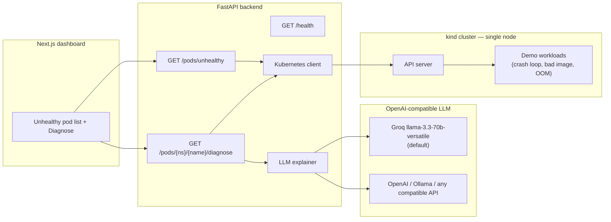

# Kube Copilot

**An AI incident copilot for Kubernetes.** Point it at a cluster, get a plain-English explanation of what broke, and a short list of `kubectl` commands to fix it.

Phase 1 (this repo state) is a working core: a FastAPI service that finds unhealthy pods, gathers status + events + logs, and asks an LLM for a structured diagnosis. A small Next.js dashboard lists the pods and shows the result.

This project is built to be resume-ready for DevOps, full-stack GenAI, and ML internship / GSoC / LFX applications. Later phases add RAG over runbooks, an ML anomaly detector on Prometheus metrics, and production-style packaging (Helm, GitHub Actions, Terraform, Grafana).

## The problem

When a pod goes into `CrashLoopBackOff`, `ImagePullBackOff`, or `OOMKilled`, the signal is scattered across `kubectl describe`, events, and current vs. previous logs. Junior operators (and tired senior ones) spend the first five minutes just assembling context. Kube Copilot does that gathering for you and returns a root-cause hypothesis you can verify.

## Architecture (Phase 1)



The backend talks to the cluster with the official Python `kubernetes` client and to the model via an OpenAI-compatible API (`LLM_BASE_URL`, `LLM_API_KEY`, `LLM_MODEL`). Groq is the default because it is fast and has a free tier that is enough for local demos; swapping in OpenAI or a local Ollama instance is a three-line `.env` change.

## Repository layout

```
kube-copilot/
├── backend/            FastAPI app, tests, Dockerfile
├── frontend/           Next.js (App Router, TypeScript, Tailwind)
├── demo/               kind config + intentionally broken manifests
├── Makefile            cluster-up, demo-break, backend-dev, frontend-dev, test
├── docker-compose.yml  optional: run API + UI in containers
└── .env.example        Groq defaults, plus OpenAI / Ollama examples
```

## Quickstart

You will need: **Python 3.11+**, **Node 20+**, **Docker**, **[kind](https://kind.sigs.k8s.io/)**, and **kubectl**. A single-node kind cluster is enough — the demo is sized for a low-spec laptop (one control-plane, `busybox` images, tight memory limits).

### 1. Clone and configure the LLM

```bash
git clone https://github.com/Kayd-06/kube-copilot.git
cd kube-copilot
cp .env.example .env
```

Create a free Groq key at [console.groq.com/keys](https://console.groq.com/keys) and put it in `.env`:

```bash
LLM_BASE_URL=https://api.groq.com/openai/v1
LLM_API_KEY=gsk_...
LLM_MODEL=llama-3.3-70b-versatile
```

Want OpenAI or a local model instead?

```bash
# OpenAI
LLM_BASE_URL=https://api.openai.com/v1
LLM_API_KEY=sk-...
LLM_MODEL=gpt-4o-mini

# Ollama (after: ollama pull llama3.2)
LLM_BASE_URL=http://localhost:11434/v1
LLM_API_KEY=ollama
LLM_MODEL=llama3.2
```

The backend loads `.env` automatically if you start it from the repo root or copy the file into `backend/`. The Makefile targets below export nothing special — the simplest path is:

```bash
# so pydantic-settings finds the file when you run uvicorn from backend/
cp .env backend/.env
```

### 2. Create a tiny cluster and break a few pods

```bash
make cluster-up     # kind cluster named kube-copilot, one node
make demo-break     # CrashLoopBackOff, ImagePullBackOff, and OOMKilled
kubectl get pods -n copilot-demo
```

### 3. Start the backend

```bash
cd backend
python3 -m venv .venv
source .venv/bin/activate
pip install -r requirements.txt
cp ../.env .env          # if you have not already
python -m pytest -v
uvicorn app.main:app --reload --host 0.0.0.0 --port 8000
```

Or from the repo root, after the venv exists: `make test` and `make backend-dev`.

Check it: [http://localhost:8000/health](http://localhost:8000/health) should return `{"status":"ok",...}`. Unhealthy pods are at [http://localhost:8000/pods/unhealthy](http://localhost:8000/pods/unhealthy).

### 4. Start the dashboard

In another terminal:

```bash
cd frontend
npm install
npm run dev
```

Open [http://localhost:3000](http://localhost:3000), click **Diagnose** on a failing pod, and read the explanation.

`make frontend-dev` does the same once `npm install` has been run once.

## API

| Method | Path | Description |
|--------|------|-------------|
| `GET`  | `/health` | Liveness. Does not touch the cluster or the LLM. |
| `GET`  | `/pods/unhealthy` | Pods in a bad state (`CrashLoopBackOff`, `Error`, `Pending`, `OOMKilled`, `ImagePullBackOff`, …). Optional `?namespace=`. |
| `GET`  | `/pods/{namespace}/{name}/diagnose` | Collects status, events, and ~200 lines of logs (including previous logs after a restart) and returns a structured diagnosis. |
| `GET`  | `/pods/{namespace}/{name}/diagnose?stream=true` | Same, as server-sent events (`context`, `token`, `diagnosis`, `done`). |

A diagnosis looks like:

```json
{
  "summary": "…",
  "likely_root_cause": "…",
  "suggested_fix": "…",
  "kubectl_commands": ["kubectl describe pod …", "kubectl logs … --previous"],
  "confidence": 0.86
}
```

## Tests

Backend tests mock the Kubernetes and LLM clients. No cluster or API key is required:

```bash
cd backend && python -m pytest -v
```

## Docker Compose (optional)

```bash
cp .env.example .env   # add LLM_API_KEY
docker compose up --build
```

The UI is on `:3000` and the API on `:8000`. Compose mounts `~/.kube` into the API container. **kind advertises the API server as `127.0.0.1`**, which from inside a container is the container itself, not your host. The most reliable Phase 1 workflow is therefore `make backend-dev` on the host, where your kubeconfig already works. If you want Compose to reach kind, change the server URL in the mounted kubeconfig to `host.docker.internal` (or use [this kind note](https://kind.sigs.k8s.io/docs/user/ingress/)).

## Roadmap

**Phase 1 — working core (current).** List unhealthy pods, gather evidence, LLM diagnosis, Next.js UI, kind demo cluster.

**Phase 2 — RAG with Qdrant.** Embed official runbooks and past incident write-ups in Qdrant. The explainer retrieves the closest fixes and cites them in the answer instead of guessing from logs alone.

**Phase 3 — ML anomaly detection.** Scrape Prometheus metrics, train an anomaly detector (Isolation Forest, then an LSTM), track experiments with MLflow, and serve the model as its own microservice so the copilot can flag issues *before* a pod enters a terminal wait reason.

**Phase 4 — DevOps polish.** Docker images already exist; this phase adds Helm charts, GitHub Actions CI/CD, Terraform for a small cloud environment, Grafana dashboards, a public demo, and an architecture-rich README.

## License

MIT © 2026 Kunal Dadlani
