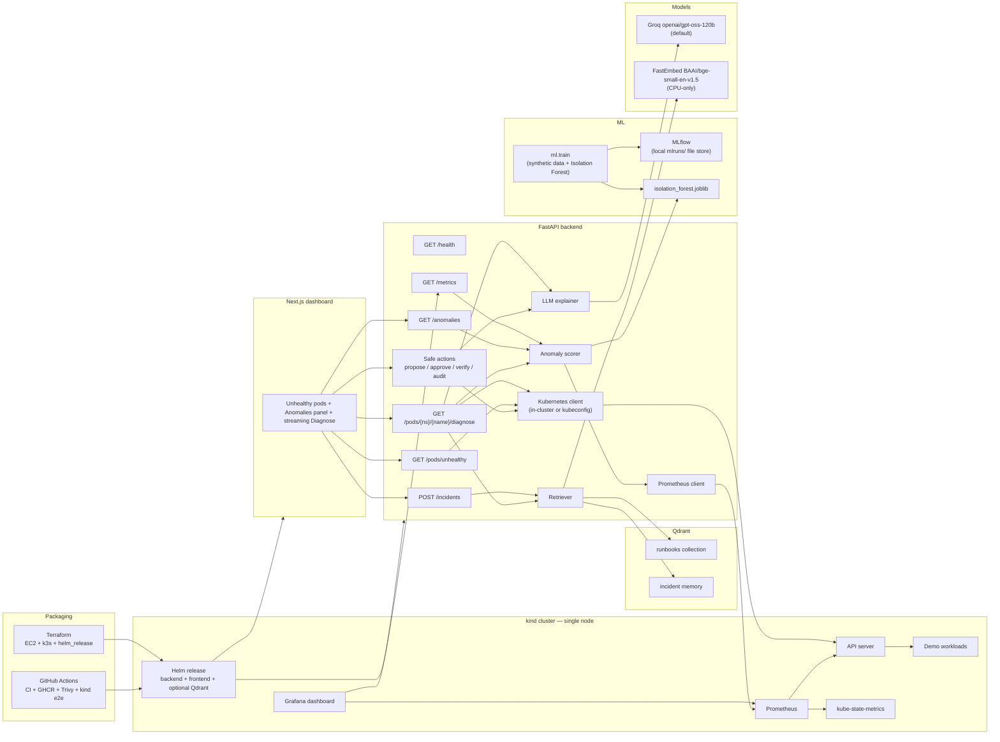

# Kube Copilot

[](https://github.com/Kayd-06/kube-copilot/actions/workflows/ci.yml)
[](https://github.com/Kayd-06/kube-copilot/actions/workflows/images.yml)
[](LICENSE)

**An AI incident copilot for Kubernetes.** Point it at a cluster, get a plain-English explanation of what broke, a short list of `kubectl` commands to fix it, citations from runbooks and past incidents, and an anomaly score over recent Prometheus metrics.

Phase 4 (this repo state) packages that stack: a Helm chart that runs the API *inside* the cluster, GitHub Actions CI (pytest, Helm lint, a kind smoke test, GHCR publish, Trivy), a Terraform module for a small k3s VM, and a Grafana dashboard. Diagnoses still work if Prometheus, Qdrant, or the model is missing; you just get an `anomaly_unavailable` or `knowledge_unavailable` flag.

It can also **propose and run a fix with a human in the loop**: the LLM picks from four allowlisted actions (rollback, rolling restart, bounded scale, delete one crashlooping pod) via function calling, policy is enforced in code, every change is dry-run on the API server and shown as a diff, nothing runs until someone approves it, and the backend then verifies recovery and writes an audit log. This is **off by default**; see [Safe actions](#safe-actions-human-in-the-loop-remediation).

See [CONTRIBUTING.md](CONTRIBUTING.md) for how to develop, [docs/DEMO.md](docs/DEMO.md) for a recording script, and [CHANGELOG.md](CHANGELOG.md) for what landed in each phase.

## The problem

When a pod goes into `CrashLoopBackOff`, `ImagePullBackOff`, or `OOMKilled`, the signal is scattered across `kubectl describe`, events, and current vs. previous logs. Junior operators (and tired senior ones) spend the first five minutes just assembling context. Some problems, like a memory leak, are visible in metrics *before* the pod enters a terminal wait reason. Kube Copilot gathers the evidence, retrieves the closest runbook sections, scores recent metrics, and returns a root-cause hypothesis you can verify — with citations.

## Architecture (Phase 4)




The backend talks to the cluster with the official Python `kubernetes` client, to Prometheus over its HTTP API (`PROMETHEUS_URL`), and to the model via an OpenAI-compatible API (`LLM_BASE_URL`, `LLM_API_KEY`, `LLM_MODEL`). Groq is the default because it is fast and has a free tier that is enough for local demos; swapping in OpenAI or a local Ollama instance is a three-line `.env` change.

Embeddings default to [FastEmbed](https://qdrant.github.io/fastembed/) with `BAAI/bge-small-en-v1.5` on CPU — nothing heavy runs on the GPU, and the model is only downloaded the first time you run `make ingest`. Tests use a deterministic hash embedder so they never download a model.

Qdrant can run three ways:

- **Docker** (default): `make qdrant-up` exposes `http://localhost:6333`.
- **On-disk embedded store** (no extra container, kinder to a low-spec laptop): set `QDRANT_PATH=.qdrant` and leave `QDRANT_URL` empty or set it to `path`.
- **In-memory**: `QDRANT_URL=:memory:` — used automatically by the test suite.

Prometheus, kube-state-metrics, and metrics-server are optional. They are installed with tight resource requests (`make metrics-up`) and exposed on the host with `make metrics-forward`. If Prometheus is down, `/anomalies` returns HTTP 503 and Diagnose still succeeds.

## Repository layout

```
kube-copilot/
├── backend/              FastAPI app, anomaly scorer, RAG helpers, tests, Dockerfile
├── backend/models/       Trained Isolation Forest artifact (committed)
├── frontend/             Next.js (App Router, TypeScript, Tailwind)
├── ml/                   Features, synthetic + real-data training, chaos collector, eval reports
├── ml/data/real/         Labelled real kind + Chaos Mesh metrics (two runs) and a data card
├── knowledge/runbooks    Markdown runbooks ingested into Qdrant
├── demo/                 kind config, broken manifests, Prometheus + Grafana, Chaos Mesh experiments
├── deploy/helm/          Helm chart (backend, frontend, optional Qdrant)
├── deploy/terraform/     Single-node k3s on a cheap AWS VM + helm_release
├── backend/app/actions/  Safe actions: policy, LLM tool calling, dry run, executor, verifier, SQLite audit
├── docs/                 DEMO recording script, safe-actions design, resume bullets, e2e reports
├── .github/workflows/    CI, GHCR publish, Dependabot, issue/PR templates
├── Makefile              cluster, metrics, grafana, chaos, collect, helm, train, ingest, dev, test
├── docker-compose.yml    Qdrant + optional API + UI containers
└── .env.example          Groq defaults, Qdrant, Prometheus, and OpenAI / Ollama examples
```

## Quickstart

You will need: **Python 3.11+**, **Node 20+**, **Docker**, **[kind](https://kind.sigs.k8s.io/)**, and **kubectl**. A single-node kind cluster is enough — the demo is sized for a low-spec laptop (one control-plane, `busybox` images, tight memory limits). Prometheus and Qdrant are optional and can be skipped.

### 1. Clone and configure the LLM

```bash
git clone https://github.com/Kayd-06/kube-copilot.git
cd kube-copilot
cp .env.example .env
```

Create a free Groq key at [console.groq.com/keys](https://console.groq.com/keys) and put it in `.env`:

```bash
LLM_BASE_URL=https://api.groq.com/openai/v1
LLM_API_KEY=gsk_...
LLM_MODEL=openai/gpt-oss-120b
```

Want OpenAI or a local model instead?

```bash
# OpenAI
LLM_BASE_URL=https://api.openai.com/v1
LLM_API_KEY=sk-...
LLM_MODEL=gpt-4o-mini

# Ollama (after: ollama pull llama3.2)
LLM_BASE_URL=http://localhost:11434/v1
LLM_API_KEY=ollama
LLM_MODEL=llama3.2
```

The backend loads `.env` automatically if you start it from the repo root or copy the file into `backend/`. The simplest path is:

```bash
cp .env backend/.env
```

### 2. Create a tiny cluster and break a few pods

```bash
make cluster-up     # kind cluster named kube-copilot, one node
make demo-break     # CrashLoopBackOff, ImagePullBackOff, OOMKilled, and a slow memory leak
kubectl get pods -n copilot-demo
```

### 3. Start Qdrant and ingest runbooks

```bash
make qdrant-up      # docker compose up -d qdrant  (http://localhost:6333)
cd backend
python3 -m venv .venv
source .venv/bin/activate
pip install -r requirements.txt
pip install -r ../ml/requirements.txt   # MLflow, only needed for `make train`
cd ..
make ingest         # python -m app.ingest — embeds knowledge/runbooks
```

The first ingest downloads the small FastEmbed model (CPU only) and upserts heading-level chunks from the runbooks. Re-running `make ingest` is idempotent.

If you would rather not run another container, skip `make qdrant-up` and in `.env` set:

```bash
QDRANT_URL=path
QDRANT_PATH=.qdrant
```

Then run `make ingest` as usual.

### 4. (Optional) Start Prometheus and train the anomaly model

A trained Isolation Forest is already committed at `backend/models/isolation_forest.joblib`, so scoring works out of the box. Retrain any time with:

```bash
make train          # writes the model, ml/reports/metrics.{json,md}, and an MLflow run
make mlflow-ui      # http://127.0.0.1:5000  (local file store ./mlruns)
```

`make train` is CPU-only and finishes in a few seconds. It does not need a cluster.

To score live pods you also need Prometheus:

```bash
make metrics-up          # Prometheus + kube-state-metrics + metrics-server, tight limits
make metrics-forward     # leave this running; http://localhost:9090
```

`PROMETHEUS_URL` defaults to `http://localhost:9090`. Wait about a minute after `metrics-up` for the first scrapes, then open the Anomalies panel. A background poller exists (`ANOMALY_POLLER_ENABLED=true`) but stays off by default so a low-spec laptop is not doing extra queries.

### 5. Start the backend

```bash
cd backend
source .venv/bin/activate
cp ../.env .env      # if you have not already
python -m pytest -v
uvicorn app.main:app --reload --host 0.0.0.0 --port 8000
```

Or from the repo root, after the venv exists: `make test` and `make backend-dev`.

Check it: [http://localhost:8000/health](http://localhost:8000/health) should return `{"status":"ok",...}`. Unhealthy pods are at [http://localhost:8000/pods/unhealthy](http://localhost:8000/pods/unhealthy). Anomaly scores are at [http://localhost:8000/anomalies](http://localhost:8000/anomalies). You can probe retrieval with [http://localhost:8000/knowledge/search?q=CrashLoopBackOff](http://localhost:8000/knowledge/search?q=CrashLoopBackOff).

Diagnose still works if Qdrant or Prometheus is not running. The response will have `"citations": []` / `"knowledge_unavailable": true`, or `"anomaly": null` / `"anomaly_unavailable": true`.

### 6. Start the dashboard

In another terminal:

```bash
cd frontend
npm install
npm run dev
```

Open [http://localhost:3000](http://localhost:3000). The Anomalies panel shows scores and a small memory sparkline; press **Diagnose** on a flagged pod (try `leak-app`) or on an unhealthy pod below. Watch the answer stream in, with citations and the anomaly breakdown underneath. After a fix you can press **Save as resolved incident** so later diagnoses can retrieve that write-up too.

`make frontend-dev` does the same once `npm install` has been run once.

## Deploy with Helm (recommended)

This is the supported way to run the API against a kind cluster: the backend pod uses in-cluster Kubernetes config, so it never has to reach an API server advertised as `127.0.0.1`.

You will need Docker, kind, kubectl, and [Helm 3](https://helm.sh/). From the repo root:

```bash
cp .env.example .env          # add your Groq key as LLM_API_KEY
make cluster-up
make demo-break
make metrics-up               # optional, for anomaly scores
make grafana-up               # optional, also starts the metrics stack
make helm-install             # builds images, loads them into kind, installs the chart
kubectl -n kube-copilot port-forward svc/kube-copilot-frontend 3000:3000
# open http://localhost:3000 — the UI proxies /api to the in-cluster backend
```

`make helm-install` creates a Secret from `LLM_API_KEY` in `.env` when the key is set. After the first install, ingest runbooks (the first run downloads a small CPU embedder):

```bash
kubectl -n kube-copilot exec deploy/kube-copilot-backend -- python -m app.ingest
```

Useful commands: `make helm-lint`, `make helm-uninstall`, `make grafana-forward` (Grafana at http://localhost:3001, `admin`/`admin`, or anonymous Viewer). The chart lives at [`deploy/helm/kube-copilot`](deploy/helm/kube-copilot); `values-kind.yaml` is already sized for a low-spec laptop.

A Terraform module at [`deploy/terraform`](deploy/terraform) can stand up a small AWS EC2 VM, install k3s, and deploy the same chart. Run `terraform fmt` / `terraform validate` freely; **do not `terraform apply` unless you intend to spend money**, and lock `ssh_cidr` to your IP first. Images are published to GHCR on `main` and on version tags.

## Grafana

`make grafana-up` installs a lightweight Grafana into the `observability` namespace and provisions a **Kube Copilot** dashboard: pod CPU and memory, container restarts, anomaly scores, diagnose latency, and LLM calls. The dashboard JSON is also at [`demo/metrics/grafana/kube-copilot-dashboard.json`](demo/metrics/grafana/kube-copilot-dashboard.json) if you want to import it into an existing Grafana.

When the API runs under Helm, Prometheus scrapes `/metrics` from the backend Service (via the `prometheus.io/scrape` annotation). When the API runs on the host, those custom metrics are still at http://localhost:8000/metrics but are not scraped unless you add a job yourself.

## Phase 3 — ML anomaly detection

The detector is an Isolation Forest trained **only on synthetic normal windows**, so you can train it on a laptop with no cluster. A generator simulates healthy pods plus three labelled failure modes (memory leak, CPU spike, restart storm). Features are computed over a rolling 3-minute window (12 samples at 15s): rates, z-scores, memory-to-limit ratio, and restart deltas. The forest is fit on a smaller high-signal subset of those features (`cpu_last`, `cpu_mean`, `mem_zscore`, `mem_slope_mib_per_min`, `mem_to_limit_ratio`, `restart_delta`, `restart_rate_per_min`) because a rare behaviour that only shows up in one or two of many features is otherwise hard for Isolation Forest to isolate.

The decision threshold is the 90th percentile of training anomaly scores (an expected 10% false-positive rate on healthy windows). The served score is a sigmoid centred on that threshold, so `0.5` is the decision boundary and higher is more anomalous. Each response also lists the features with the largest z-score against the healthy training distribution.

### Evaluation (held-out synthetic test set)

These numbers come from a real `make train` run (seed `42`, 200 trees) at 2026-11-12 18:50 IST. The same figures are in [`ml/reports/metrics.md`](ml/reports/metrics.md). Retraining with the default flags should reproduce them.

| Metric | Value |
|--------|-------|
| Precision | 0.896 |
| Recall | 0.889 |
| F1 | 0.893 |
| Accuracy | 0.893 |

Confusion matrix: TN=350, FP=40, FN=43, TP=346. Train windows (normal only): 1170. Test windows: 390 normal + 389 anomalous.

| Behaviour | Recall |
|-----------|--------|
| `normal` (specificity) | 0.897 |
| `memory_leak` | 0.792 |
| `cpu_spike` | 0.886 |
| `restart_storm` | 1.000 |

### Evaluation on real cluster metrics

The synthetic numbers above don't carry over to a real cluster, so the detector was also trained and tested on **real Prometheus data** from a single-node kind cluster while [Chaos Mesh](https://chaos-mesh.org/) injected CPU stress, memory stress, a slow memory leak, a restart storm and pod kills (`make chaos-up`, `make collect`, `make train-real`). There are two runs: `run-box-01` (67 min) for training and an in-run time split, and `run-box-02` (45 min), collected after the code was frozen and used only for testing. The data card is [`ml/data/real/README.md`](ml/data/real/README.md) and the full report is [`ml/reports/real_metrics.md`](ml/reports/real_metrics.md).

Held-out run `run-box-02`. Every model was trained on normal windows only, with its threshold set at the 90th percentile of its own training scores.

| Model (training data) | Scope | Precision | Recall | F1 | Specificity |
|---|---|---|---|---|---|
| `synthetic` (the model above) | all pods | 0.051 | 1.000 | 0.098 | 0.001 |
| `real` | all pods | 0.162 | 0.410 | 0.232 | 0.885 |
| `real+guard` | all pods | 0.227 | 0.632 | 0.334 | 0.884 |
| `real+guard` | app pods | 0.480 | 0.791 | 0.598 | 0.898 |
| `synthetic+real+guard` | app pods | **0.847** | 0.590 | **0.695** | 0.987 |

Recall on app pods in the held-out run, by scenario:

| Scenario | `real+guard` | `synthetic+real+guard` |
|---|---|---|
| `cpu_stress` | 1.000 | 1.000 |
| `memory_leak` | 1.000 | 0.867 |
| `memory_stress` | 1.000 | 0.595 |
| `restart_storm` | 1.000 | 1.000 |
| `pod_kill` | 0.372 | 0.038 |

What changed and why:
- **The synthetic model flags almost everything on real pods.** Its idea of "normal" (50 to 100 MiB, about 0.05 cores) doesn't match idle nginx pods, so it is not usable on a real cluster without real training data.
- **Range guard.** Isolation Forest can't score a point far outside its training range any higher than the most extreme training point, so pegged CPU went undetected (cpu_stress recall was 0.05 on run 1). The guard flags any model feature more than one training-range width outside its [p0.5, p99.5] band.
- **App-namespace scope.** Most false positives were in `chaos-mesh`, `kube-system` and `observability`. Those pods are cluster plumbing, and the chaos experiments themselves drive their load. Scoring only app pods raised precision the most.

Caveats: the guard and the app scope were chosen after seeing run 1, and the held-out run is the honest test of them. This is about 1.9 hours from one laptop-sized node, the windows overlap, and anomalies are only 5 to 11% of test windows. The held-out numbers come from a single run, so read them as directional. `pod_kill` stays mostly undetected because a 3-minute per-pod window never sees its own pod being deleted, and `network_delay` couldn't be collected on the box (its kernel has no `netem`). The API still serves the synthetic model by default. To try the real-data model, run `make train-real` and set `ANOMALY_MODEL_PATH=backend/models/isolation_forest_real.joblib`.

### Pod kills: events and lifecycle state

A killed pod just stops reporting metrics, so the forest caught about 4% of `pod_kill` windows. A second, rule-based detector ([`ml/lifecycle.py`](ml/lifecycle.py)) reads what the cluster says happened instead. It looks for pod replacements and disappearances that no scale-up or rollout explains, available replicas below desired, container restarts, and disruption events on pods and ReplicaSets (`Killing`, `BackOff`, `OOMKilling`, `Evicted`, `NodeNotReady`, ...). Events about Chaos Mesh's own objects are never used. The API marks a pod anomalous when either detector fires. `/anomalies` returns `metric_anomaly`, `detectors` and `lifecycle_signals` for each pod, plus workload-level `disruptions` that still show pods which no longer exist.

The detector was scored on `run-box-03` (63 min, 3 pod-kill windows plus the other faults, with Kubernetes events and kube-state-metrics lifecycle series recorded). That run was collected after the rules were frozen. Results on app pods, 3-minute windows ([`ml/reports/lifecycle_metrics.md`](ml/reports/lifecycle_metrics.md)):

| Detector | Precision | Recall | F1 | `pod_kill` recall |
|---|---|---|---|---|
| Isolation Forest (`synthetic+real+guard`) | 0.555 | 0.330 | 0.413 | 0.037 |
| Lifecycle rules | 0.617 | 0.614 | 0.615 | 0.851 |
| **Union** | 0.570 | **0.824** | **0.674** | **0.851** |

Overall recall here is lower than on `run-box-02` because pod-kill windows make up 214 of the 352 anomalous windows. The lifecycle rules catch none of the CPU, memory-stress or memory-leak windows, so the forest is still needed for those. Most of the lifecycle false positives (132 of 134 windows) come from one real `NodeNotReady` episode, when the box VM paused. If you drop those windows, which is a post-hoc check and not the headline number, union precision goes to 0.751 and F1 to 0.779. Pod-kill recall stops at 0.85 because the chaos schedule's first kill lands about 60s into each window. This is one run on one node, so treat it as directional.

An optional LSTM autoencoder lives in `ml/lstm.py` behind a heavy extra (`pip install -r ml/requirements-lstm.txt`, then `python -m ml.train --model lstm`). It is **not** served by the API and is skipped on a low-spec laptop; Isolation Forest is the default model.

MLflow tracking uses a local file store at `./mlruns` (gitignored). MLflow 3.x needs `MLFLOW_ALLOW_FILE_STORE=true`, which `make train` and `make mlflow-ui` already set.

## Safe actions (human-in-the-loop remediation)

Off by default. Turn it on with `ACTIONS_ENABLED=true` (host) or `--set actions.enabled=true --set 'actions.namespaces={copilot-demo}'` (Helm). Design and every guardrail: [docs/SAFE_ACTIONS.md](docs/SAFE_ACTIONS.md).

1. On a diagnosis, press **Propose remediation**. The backend sends the evidence and the owning Deployment's current and previous revision to the LLM with five tools: `rollback_deployment`, `restart_deployment`, `scale_deployment`, `delete_pod`, `no_action`.
2. Each tool call is checked in code: allowlisted tool, exact parameters, namespace allow/deny list (`kube-system` and `chaos-mesh` are never allowed by default), target must be the incident pod or its Deployment, replicas within `[ACTIONS_SCALE_MIN, ACTIONS_SCALE_MAX]`, rollback needs a previous revision, `delete_pod` only for a crashlooping, Deployment-owned pod. Anything else is shown as **blocked** with the reason.
3. Allowed proposals are dry-run on the API server (`dryRun=All`) and shown as a before/after diff.
4. **Approve** or **Reject**. Approval re-checks the policy on fresh state and enforces the kill switch (`ACTIONS_KILL_SWITCH`), a 15-minute TTL, one action in flight per workload, a 120 s per-workload cooldown and an hourly cap.
5. After execution the backend watches the Deployment (ready/available/updated replicas, bad pods, new restarts, lifecycle disruption signals) for up to 180 s and marks it **resolved** after 20 s of stable health, with the time to recovery. Scale and rollback can be reverted through a new proposal that needs its own approval.
6. Every step lands in a SQLite audit log: `GET /audit`, `GET /actions/{id}` and the `/audit` page.

Helm only grants write RBAC when `actions.enabled=true`, as one namespaced `Role` per entry in `actions.namespaces` with exactly `patch deployments`, `get/patch deployments/scale` and `delete pods`. The chart refuses to render with `kube-system` or another denied namespace.

**Measured on kind** ([report](docs/reports/safe_actions_e2e.md), 12 trials): for a bad image tag, a bad command and a bad image with `Recreate` (full outage), the LLM proposed `rollback_deployment` 9/9 times and all 9 approved rollbacks were verified as resolved. In the full-outage case the Deployment was healthy again 3.3 to 11.7 s after approval (median 3.4 s). Proposals took about 1 s. For a crashloop caused by a config value that had already been fixed, the model declined all 3 times (`no_action`), which was a miss: a restart would have helped. These runs used Groq `openai/gpt-oss-120b`, which is now the project default.

## API

| Method | Path | Description |
|--------|------|-------------|
| `GET`  | `/health` | Liveness. Does not touch the cluster, Qdrant, Prometheus, or the LLM. |
| `GET`  | `/metrics` | Prometheus metrics (HTTP timings plus diagnose latency, LLM calls, and per-pod anomaly scores). |
| `GET`  | `/pods/unhealthy` | Pods in a bad state (`CrashLoopBackOff`, `Error`, `Pending`, `OOMKilled`, `ImagePullBackOff`, …). Optional `?namespace=`. |
| `GET`  | `/pods/{namespace}/{name}/diagnose` | Collects status, events, and ~200 lines of logs, retrieves top-k runbook/incident chunks, scores recent metrics, and returns a structured diagnosis plus `citations` and `anomaly`. |
| `GET`  | `/pods/{namespace}/{name}/diagnose?stream=true` | Same, as server-sent events (`context`, `citations`, `token`, `diagnosis`, `done`; `warning` if Qdrant or the anomaly path is down). |
| `GET`  | `/anomalies` | Score recent per-pod Prometheus metrics and merge lifecycle signals (`is_anomaly` = forest OR lifecycle; also `metric_anomaly`, `detectors`, `lifecycle_signals`, and workload `disruptions`). Optional `?namespace=` and `?flagged_only=true`. HTTP 503 if the model file or Prometheus is missing; `lifecycle_unavailable: true` if the Kubernetes API can't be read. |
| `GET`  | `/disruptions` | Workloads with pod kills, replacements, replica dips, restarts or disruption events in the last `ANOMALY_WINDOW_SECONDS` (default 180). Kubernetes API only, so it works without Prometheus or a model. Optional `?namespace=`. |
| `GET`  | `/pods/{namespace}/{name}/anomaly` | Score one pod. HTTP 404 if Prometheus has no series for it yet. |
| `POST` | `/incidents` | Save a resolved incident (`pod_name`, `namespace`, `reason`, `root_cause`, `fix`, optional `notes`) into the incidents collection. |
| `GET`  | `/knowledge/search?q=` | Debug search over runbooks and incidents. Optional `&k=5`. |
| `GET`  | `/actions/config` | Safe-actions settings: enabled, kill switch, namespaces, scale bounds, cooldown. |
| `POST` | `/pods/{namespace}/{name}/actions/propose` | Ask the LLM for remediation; returns policy-checked, dry-run proposals. HTTP 403 when actions are disabled. |
| `GET`  | `/actions`, `/actions/{id}` | Proposals and their status; the detail includes the audit timeline and verification samples. |
| `POST` | `/actions/{id}/approve`, `/actions/{id}/reject` | Body `{"actor": "...", "comment": "..."}`. 409 if not approvable, 423 kill switch, 429 cooldown or hourly cap. |
| `POST` | `/actions/{id}/revert` | Creates a new proposal that undoes a scale or rollback. Needs its own approval. |
| `GET`  | `/audit` | Append-only audit log. Optional `?action_id=` and `?limit=`. |

A diagnosis looks like:

```json
{
  "summary": "…",
  "likely_root_cause": "…",
  "suggested_fix": "…",
  "kubectl_commands": ["kubectl describe pod …", "kubectl logs … --previous"],
  "confidence": 0.86,
  "citations": [
    {
      "title": "CrashLoopBackOff",
      "source": "crashloopbackoff.md",
      "section": "Common causes",
      "score": 0.81,
      "kind": "runbook"
    }
  ],
  "knowledge_unavailable": false,
  "anomaly": {
    "namespace": "copilot-demo",
    "name": "leak-app-…",
    "score": 0.91,
    "is_anomaly": true,
    "threshold": 0.013,
    "contributing_features": [
      {"name": "mem_slope_mib_per_min", "value": 12.1, "zscore": 6.2, "direction": "high"}
    ],
    "series": [{"ts": 1700000000, "cpu": 0.08, "memory_mib": 28.0, "mem_to_limit_ratio": 0.44, "restarts": 0}]
  },
  "anomaly_unavailable": false
}
```

## Tests

Backend tests mock the Kubernetes, LLM, and Prometheus clients, use an in-memory Qdrant plus a deterministic fake embedder, and train a tiny Isolation Forest in-process where needed. No cluster, API key, model download, or Prometheus is required:

```bash
cd backend && python -m pytest -v
```

## Docker Compose (optional)

```bash
cp .env.example .env   # add LLM_API_KEY
docker compose up --build
docker compose exec backend python -m app.ingest
```

The UI is on `:3000` (it proxies `/api` to the backend), the API on `:8000`, and Qdrant on `:6333`. Compose still mounts `~/.kube` into the API container, and **kind advertises the API server as `127.0.0.1`**, which from inside a container is the container itself. The reliable ways to run this are:

- **Host process** (fastest loop): `make qdrant-up && make ingest && make backend-dev` plus `make frontend-dev`, where your kubeconfig already works.
- **In-cluster Helm** (the supported packaging path): `make helm-install`. The backend uses in-cluster config and a least-privilege ServiceAccount, so the `127.0.0.1` gap does not apply.

If you really want Compose to reach kind, change the server URL in the mounted kubeconfig to `host.docker.internal` (or see [this kind note](https://kind.sigs.k8s.io/docs/user/ingress/)). Prometheus is installed *in* the kind cluster, not in Compose, so keep `make metrics-forward` running on the host when the API is a host process, or rely on the in-cluster Service URL when the API runs under Helm.

## Roadmap

**Phase 1 — working core.** List unhealthy pods, gather evidence, LLM diagnosis, Next.js UI, kind demo cluster.

**Phase 2 — RAG with Qdrant.** Embed hand-written troubleshooting runbooks and past incident write-ups in Qdrant. The explainer retrieves the closest fixes, streams the answer, and cites them instead of guessing from logs alone.

**Phase 3 — ML anomaly detection.** Scrape Prometheus metrics, train an Isolation Forest on synthetic pod behaviour, track experiments with MLflow, and serve scores from the API so the copilot can flag issues *before* a pod enters a terminal wait reason. An optional LSTM autoencoder is documented but not required.

**Phase 4 — DevOps polish.** Helm chart, GitHub Actions (tests, Helm lint, kind e2e, GHCR publish, Trivy), Terraform for a single-node k3s VM, Grafana dashboards, and `/metrics` on the API. Next steps that are *not* in this repo yet: evaluating the detector on real cluster metrics, and a published live demo environment.

**Since then.** Real-data training on Chaos Mesh runs, a pod-disruption detector driven by Kubernetes events, and human-in-the-loop safe actions (LLM tool calling restricted to four actions, policy in code, server-side dry run, approval, verification, audit log). Not done yet: authentication for approvers, StatefulSet/DaemonSet actions, and a published live demo.

## License

MIT © 2026 Kunal Dadlani
