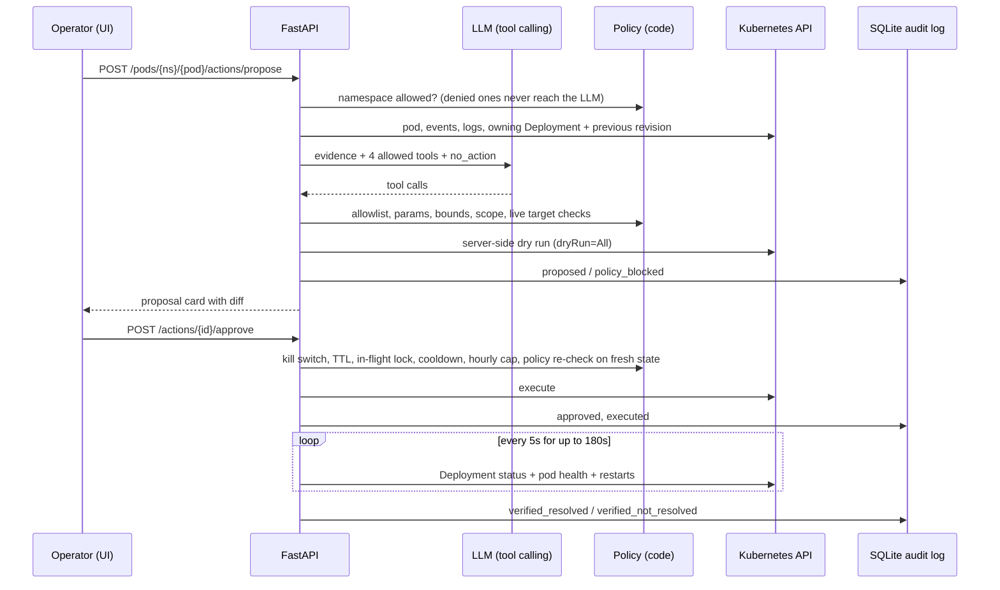

# Safe actions: human-in-the-loop remediation

Kube Copilot can propose a fix for an incident and run it after a person approves it. The LLM only ever *proposes*: policy is enforced in Python, every change is dry-run on the API server first, and nothing touches the cluster until someone presses **Approve**.

The feature is **off by default**. With `ACTIONS_ENABLED=false` (Helm `actions.enabled=false`) the API stays read-only, the chart creates no write RBAC, and the propose/approve endpoints return 403.

## Flow

## The four allowed actions

| Tool | What it does | Kubernetes call | Revert offered |
|---|---|---|---|
| `rollback_deployment` | Put the previous ReplicaSet's pod template back (`kubectl rollout undo`) | JSON patch `replace /spec/template` on the Deployment | Yes: roll back again |
| `restart_deployment` | Rolling restart (`kubectl rollout restart`) | patch `spec.template.metadata.annotations["kubectl.kubernetes.io/restartedAt"]` | No (nothing to undo) |
| `scale_deployment` | Set replicas within `[ACTIONS_SCALE_MIN, ACTIONS_SCALE_MAX]` | patch `deployments/scale` | Yes: scale back to the old count |
| `delete_pod` | Delete one crashlooping pod so its ReplicaSet recreates it | delete pod | No |

A revert is never executed directly. It creates a new proposal that goes through the same policy, dry run and approval.

Anything else the model asks for (`kubectl_exec`, `delete_namespace`, `cordon_node`, a misspelled tool, unparseable arguments) is recorded as **blocked** with the reason, and can never be approved.

## Guardrails (all enforced in code: `backend/app/actions/policy.py`, `service.py`)

- **Off by default** and a **global kill switch** (`ACTIONS_KILL_SWITCH=true`): proposals still work, approvals return 423 and nothing runs.
- **Namespace allow list** (`ACTIONS_ALLOWED_NAMESPACES`, default `copilot-demo`) and **deny list** (`ACTIONS_DENIED_NAMESPACES`, default `kube-system,kube-public,kube-node-lease,chaos-mesh,observability,kube-copilot`). The deny list wins, and `kube-system` is refused in code even if someone removes it from the list. For a denied namespace the LLM is not even called.
- **Scope**: an action may only target the incident pod or the Deployment that owns it, in the incident namespace. A hallucinated or different target is blocked.
- **Strict parameters**: exact parameter set per tool, Kubernetes name validation, integer replicas inside the bounds, scaling to the current count is a no-op and refused.
- **Live target checks**: the Deployment must exist; rollback needs a previous revision; `delete_pod` needs a pod that is controlled by a ReplicaSet owned by a Deployment *and* is crashlooping.
- **Server-side dry run** (`dryRun=All`) for every proposal, with a before/after diff in the UI. If the API server would refuse it, the proposal is blocked.
- **Explicit human approval** with a recorded name; reject is recorded too.
- **Policy re-check at approval** against fresh cluster state (for example, a pod that recovered on its own can no longer be deleted).
- **Proposal TTL** (`ACTIONS_PROPOSAL_TTL_SECONDS`, 900): old proposals expire.
- **One action in flight per workload**, a **per-workload cooldown** (`ACTIONS_COOLDOWN_SECONDS`, 120) and an **hourly cap** (`ACTIONS_MAX_PER_HOUR`, 10).
- **Least-privilege RBAC** in Helm: only when `actions.enabled=true`, one `Role` per namespace in `actions.namespaces` (no ClusterRole) with `patch deployments`, `get/patch deployments/scale`, `delete pods`. The chart refuses to render with `kube-system` or another denied namespace, with no namespaces, or with more than one backend replica (the lock and SQLite log are per pod).

## Verification

After execution the backend polls the Deployment every `ACTIONS_VERIFY_INTERVAL_SECONDS` (5) for up to `ACTIONS_VERIFY_WINDOW_SECONDS` (180). A sample is healthy when the controller has observed the new generation, `updated == ready == available == desired`, no pod of the workload is in a bad state (CrashLoopBackOff, ImagePullBackOff, ...) and no container restarted since the last sample. **Resolved** means healthy for `ACTIONS_VERIFY_STABLE_SECONDS` (20) in a row, with no new disruption signals from the lifecycle detector for that workload during the stable period (signals a rollout produces by design, such as pod replacements and `Killing`/`SuccessfulCreate`, are ignored). Time to recovery is measured from execution to the first sample of that stable streak, so its resolution is the poll interval.

The Isolation Forest verdict for the workload's pods is attached as `metric_anomalies`, but it is informational and does not decide the outcome: its 3-minute window still contains pre-fix data right after a fix.

## Audit log

Every step is appended to SQLite (`ACTIONS_AUDIT_PATH`, default `backend/data/actions.sqlite`; `/data/actions.sqlite` in Helm, on an emptyDir unless `actions.audit.persistence.enabled=true`): `proposal_requested`, `proposal_refused`, `proposed`, `policy_blocked`, `no_action_proposed`, `approved`, `rejected`, `kill_switch_blocked`, `rate_limited`, `expired`, `policy_blocked_at_approval`, `executed`, `execution_failed`, `verification_started`, `verified_resolved`, `verified_not_resolved`, `revert_requested`.

Exposed via `GET /audit` and `GET /actions/{id}` (with its timeline), and the `/audit` page in the dashboard.

## API

| Method | Path | Notes |
|---|---|---|
| GET | `/actions/config` | enabled, kill switch, namespaces, bounds |
| POST | `/pods/{ns}/{pod}/actions/propose` | body `{"actor": "name"}` optional; 403 when disabled |
| GET | `/actions` | `?status=&namespace=&limit=` |
| GET | `/actions/{id}` | record + timeline |
| POST | `/actions/{id}/approve` | body `{"actor": "name", "comment": "..."}`; 409 not proposed / blocked / in flight / expired, 423 kill switch, 429 cooldown or cap |
| POST | `/actions/{id}/reject` | body `{"actor": "name"}` |
| POST | `/actions/{id}/revert` | creates a new revert proposal |
| GET | `/audit` | `?action_id=&limit=` |

## Known limits

- There is no authentication in Kube Copilot yet; the approver name is self-declared. Put the UI behind your SSO/ingress auth before enabling actions anywhere shared.
- Only Deployments (and their pods) are supported, not StatefulSets or DaemonSets.
- The lock and audit log are per backend pod, so the chart forces one backend replica when actions are on.
- Verification proves the Deployment converged and stayed healthy for 20 s. It does not prove the application is correct for users.
- Measured results on kind: [reports/safe_actions_e2e.md](reports/safe_actions_e2e.md).
